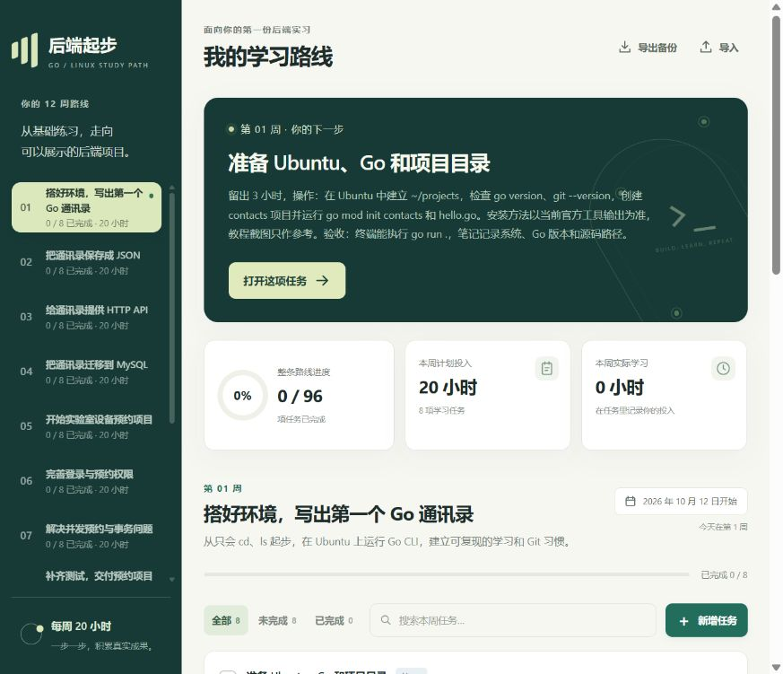
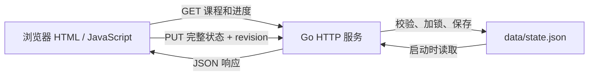

# Go + Linux 后端实习学习 TodoList

这是给 Go 与 Linux 初学者使用的本机学习工具：内置 12 周、每周 20 小时的课程，可以勾选任务、记笔记、记录实际分钟、添加任务、设置开始日期，并导入或导出 JSON 备份。

课程面向掌握 C/Python 基本语法、刚开始使用 Linux 的计算机专业研究生，以北上广深杭的 Go 后端实习为方向。前 4 周逐步完成 CLI → JSON → HTTP → MySQL 通讯录；第 5–8 周完成实验室设备预约、登录权限、并发事务和测试，并从第 5 周开始投递；第 9–12 周练习缓存、Docker、排错与面试。Linux、Git、算法和计算机基础穿插其中。

每周有 8 个任务，预计共 1200 分钟；12 周共 96 个任务、240 小时。每周的 20 小时包含 30 分钟复盘和 30 分钟主动休息。建议按 5 天每天 3 小时、周末共 5 小时分配，也可以按课程安排调整。任务说明均包含具体操作和验收条件。新增自定义任务时，请从既有任务中挪出时间，避免超过每周预算。



## 运行起来

本工具使用 Go 标准库提供后端，把 HTML、CSS、JavaScript 和课程 JSON 通过 `embed` 打包。运行它需要 Go，不需要 npm，也不需要外部数据库。课程里的 MySQL、Redis 和 Docker 用于你之后编写的通讯录或预约项目，与这个 TodoList 的启动无关。

源码在 Windows 中的展示目录是 `D:\Codex_project\go-linux-study-todolist`；建议在 Ubuntu 中使用 `~/projects/go-linux-study-todolist`。项目的 `go.mod` 声明 Go 1.22，使用当前安装的兼容 Go 版本即可。先在终端确认环境：

```bash
go version
git --version
```

已有源码时，在 Ubuntu 项目目录运行：

```bash
cd ~/projects/go-linux-study-todolist
go run .
```

之后在浏览器打开 **http://127.0.0.1:8787**。终端保持运行；按 `Ctrl+C` 停止服务。第一次启动会建立 `data/state.json`。

仓库地址是 [mzzzmnq/go-linux-study-todolist](https://github.com/mzzzmnq/go-linux-study-todolist)，可以从新目录复制源码：

```bash
mkdir -p ~/projects
cd ~/projects
git clone https://github.com/mzzzmnq/go-linux-study-todolist.git
cd go-linux-study-todolist
go run .
```

Windows 本机安装了 Go 且 `go version` 可执行时，也可以在展示目录双击 `start-windows.cmd` 启动。窗口保持打开，再访问同一个浏览器地址；按 `Ctrl+C` 停止。

## 使用与保存

先设置学习开始日期，再按周查看任务。完成操作并满足验收条件后勾选任务，把疑问、命令、错误原因和修复写在笔记里，填写实际投入分钟。每周复盘实际投入与计划的差距，再调整后续安排。

勾选、笔记、实际分钟、自定义任务和开始日期保存到 Go 服务管理的 JSON 文件中。关闭浏览器后记录仍在；服务停止再重启后也能读取。关闭终端会停止服务，此时网页无法继续保存。它不依靠浏览器缓存保存进度。

使用页面的 JSON 导出功能备份，导入备份可恢复记录。导入会替换当前记录，操作前先导出当前进度。多台电脑之间不会自动同步，可以用导出、传输、导入的方式迁移。备份可能包含个人笔记，按自己的需要保管。

默认数据位置是**启动时工作目录**下的 `data/state.json`。无论源码还是编译后的程序，换一个目录启动都可能得到新的数据目录；终端会打印实际保存路径。`data/` 和生成的二进制已加入 `.gitignore`。

## 测试与编译

在项目目录执行：

```bash
go test ./...
go test -race ./...
go build -o study-todo .
./study-todo
```

`go run .` 临时编译并启动当前源码，适合边学边改；`go build -o study-todo .` 生成可重复启动的可执行文件，之后 `./study-todo` 不需要再次编译。网页与课程已嵌入二进制，不需要另带 `web/` 或 `curriculum.json`；学习记录仍单独保存。修改源码、网页或课程后，需要重新运行 `go run .`，或重新编译并启动。

Linux 编译出的文件用于 Linux；Windows 本机编译可用 `go build -o study-todo.exe .`，然后在 PowerShell 执行 `.\study-todo.exe`。竞态检测 `-race` 需要当前平台支持和 C 编译器；若环境缺少这些条件，按错误提示补齐后再运行。

## 更改端口和数据目录

可设置两个环境变量：

| 变量 | 默认值 | 用途 |
| --- | --- | --- |
| `STUDY_ADDR` | `127.0.0.1:8787` | 监听地址；仅接受回环地址，例如 `127.0.0.1:8788` 或 `localhost:8788` |
| `STUDY_DATA_DIR` | `./data` | 存放 `state.json` 的目录；可用绝对路径保持保存位置固定 |

Ubuntu 示例：

```bash
STUDY_ADDR=127.0.0.1:8788 STUDY_DATA_DIR="$HOME/study-data" go run .
```

然后访问 `http://127.0.0.1:8788`。若默认端口被占用，可以换端口；若提示无法保存，检查终端打印的数据路径、目录写权限和磁盘空间。数据文件格式错误时服务会保留原文件并停止，请先备份后排查。

这是个人本机服务，无需登录账号，仅允许本机访问，适合自己使用。它没有公网部署所需的用户管理与身份验证，不应作为公共站点发布。

## 一次操作如何到达文件

1. 浏览器请求 `/`，Go 返回嵌入的网页文件。
2. 网页通过 `GET /api/plan` 获取课程，通过 `GET /api/state` 获取已有进度。
3. 你修改进度后，网页用 `PUT /api/state` 发送完整状态和当前 `revision`。
4. Go 校验数据并检查修订号，在锁保护下写入临时文件、替换 `state.json`，再返回新的状态。
5. 网页使用服务器返回的新修订号继续保存。若另一个窗口先保存了数据，旧修订号会收到 `409`，需要重新读取后再操作。



## 学习资源与继续开发

课程优先使用 [李文周 Go 学习目录](https://liwenzhou.com/posts/go/golang-menu/)、[Go by Example 中文](https://gobyexample-cn.github.io/) 和 [计算机教育中缺失的一课](https://missing-semester-cn.github.io/)。从任务指定主题找到对应章节，再把示例改成自己的代码。部分页面或截图可能较旧，涉及安装、工具参数和依赖时，要用当前环境的版本、帮助信息和实际运行结果校验。

[开发教程](docs/DEVELOPMENT.md) 按目录、模型、API、保存、前端和测试解释这个工具，并给出一个可独立完成的小改动。

本项目是 AI 辅助生成的学习示范。把它用于学习时，应能解释请求流程和代码，独立修改并验证一项功能。简历应如实说明自己的实现、修改与验证，不将现成示范描述为全部独立开发，也不编造用户数、生产运行或性能成果。完成 12 周计划代表完成这一阶段的练习，面试与实习准备还需根据反馈持续调整。

自动测试配置示例见 [github-actions-example.yml](docs/github-actions-example.yml)。目前没有启用 GitHub Actions；需要时将该文件放到 .github/workflows/test.yml，并使用具备 workflow 权限的 GitHub 认证提交。
